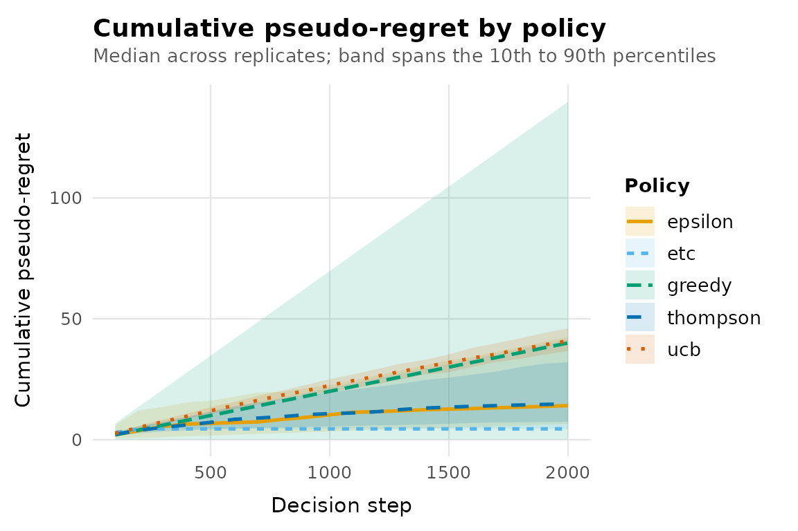

# Comparing bandit policies

``` r

library(banditlab)
```

Comparing stochastic policies fairly requires more than running each
once and ranking the totals. This vignette shows the workflow banditlab
is built around: replication, paired randomness, explicit metrics and
uncertainty on every summary.

## What regret is, exactly

banditlab reports pseudo-regret: the cost, in expectation, of the arms
you chose relative to always choosing the best arm. If arm `a` has true
expected reward `mu[a]` and the best arm has `mu_star`, each selection
of `a` contributes `mu_star - mu[a]`. See
[`?regret_definitions`](https://rprodigest.github.io/banditlab/reference/regret_definitions.md)
for all definitions. Regret requires knowing the true expected rewards,
which is exactly what simulation gives you and deployment does not; that
is why simulation is the right place to compare policies.

## A harder problem

Small gaps between arms make learning hard. Here the best arm is only
0.02 better than the runner-up.

``` r

env <- bandit_bernoulli(c(a = 0.10, b = 0.12, c = 0.05))

result <- run_experiment(
  env,
  policies = list(
    greedy   = policy_greedy(),
    epsilon  = policy_epsilon_greedy(0.1),
    etc      = policy_etc(explore_steps = 50),
    ucb      = policy_ucb1(),
    thompson = policy_thompson()
  ),
  horizon = 2000,
  replications = 100,
  seed = 2026,
  checkpoints = seq(100, 2000, by = 100)
)

summary(result)
#> # A tibble: 5 × 8
#>   policy   replications mean_regret median_regret regret_q025 regret_q975
#> * <chr>           <int>       <dbl>         <dbl>       <dbl>       <dbl>
#> 1 greedy            100        42.1          40.0        0.09       140. 
#> 2 epsilon           100        20.4          14.1        5.84        54.1
#> 3 etc               100        17.8           4.5        4.5         41.5
#> 4 ucb               100        41.0          40.9       33.8         49.1
#> 5 thompson          100        17.0          14.9        5.43        38.0
#> # ℹ 2 more variables: mean_reward <dbl>, mean_optimal_share <dbl>
```

## Trajectories, not just totals

Final numbers hide when regret was accumulated. The band plot shows the
median across replicates with a 10th to 90th percentile ribbon.

``` r

autoplot(result, metric = "cumulative_regret")
```



A flattening curve means the policy has effectively identified the best
arm; a straight line means it is still paying a constant exploration
tax.

## Paired comparisons

Because every policy runs each replicate from the same random number
stream, per-replicate differences are paired.
[`compare_policies()`](https://rprodigest.github.io/banditlab/reference/compare_policies.md)
returns the paired differences so that between-replicate noise cancels.

``` r

cmp <- compare_policies(result, baseline = "epsilon")
head(cmp)
#> # A tibble: 6 × 6
#>   policy baseline replicate policy_value baseline_value difference
#>   <chr>  <chr>        <int>        <dbl>          <dbl>      <dbl>
#> 1 greedy epsilon          1       139.            23.1      116.  
#> 2 greedy epsilon          2        40.0           19.4       20.6 
#> 3 greedy epsilon          3         0.09           6.05      -5.96
#> 4 greedy epsilon          4         2.21          42.0      -39.8 
#> 5 greedy epsilon          5       140.            55.2       84.4 
#> 6 greedy epsilon          6         0.09           7         -6.91
```

Summarise them however you like; the distribution of differences is the
honest answer to “which policy is better here”.

``` r

stats <- aggregate(difference ~ policy, data = cmp, FUN = function(x) {
  c(mean = mean(x),
    q025 = unname(quantile(x, 0.025)),
    q975 = unname(quantile(x, 0.975)),
    share_better = mean(x < 0))
})
stats
#>     policy difference.mean difference.q025 difference.q975
#> 1      etc        -2.57480       -46.51000        35.47975
#> 2   greedy        21.66380       -40.10600       132.49825
#> 3 thompson        -3.35640       -41.66450        24.52100
#> 4      ucb        20.65030       -13.12750        39.99750
#>   difference.share_better
#> 1                 0.75000
#> 2                 0.53000
#> 3                 0.50000
#> 4                 0.16000
```

For `cumulative_regret`, a negative difference means the policy beat the
baseline in that replicate, and `share_better` is the fraction of
replicates where it did.

## Do not crown a universal winner

Rankings depend on the environment: the reward gaps, the horizon, the
noise. A policy that wins here can lose under a shorter horizon or a
different gap structure. Sweep the conditions before concluding
anything; the engine makes that cheap.

``` r

short <- run_experiment(
  env,
  policies = list(etc = policy_etc(50), thompson = policy_thompson()),
  horizon = 200, replications = 100, seed = 2026
)
summary(short)
#> # A tibble: 2 × 8
#>   policy   replications mean_regret median_regret regret_q025 regret_q975
#> * <chr>           <int>       <dbl>         <dbl>       <dbl>       <dbl>
#> 1 etc               100        4.86          4.5         4.5         5.5 
#> 2 thompson          100        3.97          3.92        2.07        6.43
#> # ℹ 2 more variables: mean_reward <dbl>, mean_optimal_share <dbl>
```

Explore-then-commit with 50 exploration pulls per arm spends 150 of 200
steps exploring; the same configuration that was competitive at horizon
2000 is dominated at horizon 200. The lesson generalises: report the
conditions with the conclusion.
