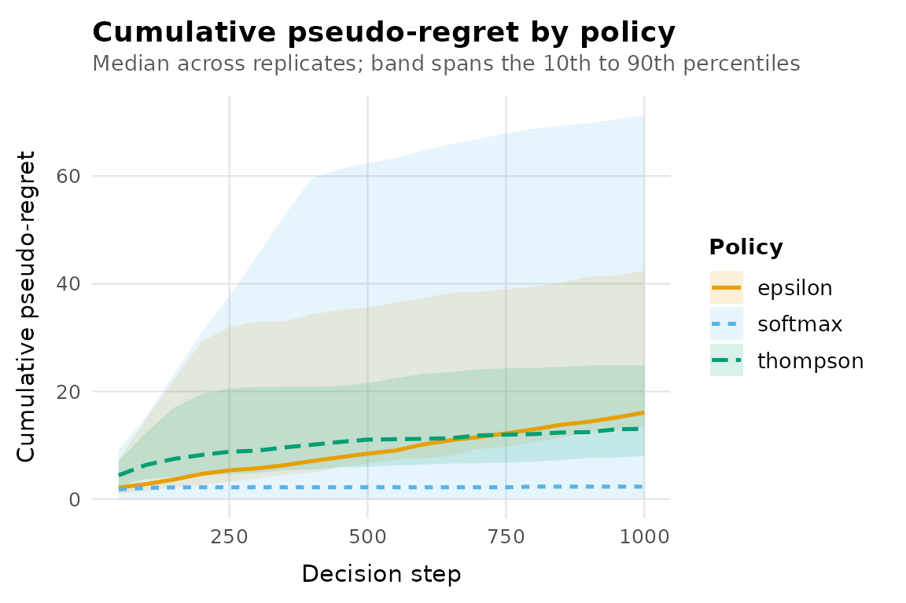

# Creating custom bandit policies

``` r

library(banditlab)
```

banditlab’s engine drives every policy through three S3 generics. If you
can write those three functions, you can run any policy from any
research paper against the built-in environments, replicate it, and
compare it with the built-in policies. Nothing in the package needs to
be modified.

The lifecycle:

1.  `policy_state(policy, arms)` initialises runtime state once per
    replicate (and is the reset).
2.  `select_arm(policy, t)` picks an arm at step `t`.
3.  `update_state(policy, arm, reward, t)` incorporates the observed
    reward.

This vignette implements Boltzmann (softmax) exploration from scratch:
arms are selected with probability proportional to
`exp(estimate / temperature)`.

## 1. The constructor: configuration only

The constructor validates and stores configuration. It knows nothing
about arms or environments, which is what lets one configuration run
against any environment.

``` r

policy_softmax <- function(temperature = 0.1) {
  stopifnot(
    is.numeric(temperature),
    length(temperature) == 1,
    is.finite(temperature),
    temperature > 0
  )
  structure(
    list(temperature = temperature),
    class = c("softmax_policy", "bandit_policy")
  )
}
```

The class vector matters: your class first, `"bandit_policy"` last.

## 2. State initialisation

[`policy_state()`](https://rprodigest.github.io/banditlab/reference/policy_interface.md)
receives the arm names from the environment and must return the policy
with any state fields added. Because it can be called repeatedly, always
build the state from scratch here.

``` r

policy_state.softmax_policy <- function(policy, arms, ...) {
  policy$arms <- arms
  policy$pulls <- setNames(rep(0L, length(arms)), arms)
  policy$reward_sum <- setNames(rep(0, length(arms)), arms)
  policy
}
```

## 3. Selection

[`select_arm()`](https://rprodigest.github.io/banditlab/reference/policy_interface.md)
must return a list with `arm`. Returning `propensity`, the marginal
probability of the selected arm, is optional but strongly recommended:
it is what makes the resulting logs usable for importance-weighted
offline evaluation. Softmax makes this easy because the selection
probabilities are explicit.

``` r

select_arm.softmax_policy <- function(policy, t, ...) {
  estimates <- ifelse(
    policy$pulls > 0,
    policy$reward_sum / pmax(policy$pulls, 1),
    0
  )
  centred <- (estimates - max(estimates)) / policy$temperature
  probabilities <- exp(centred) / sum(exp(centred))
  index <- sample.int(length(policy$arms), 1, prob = probabilities)
  list(
    arm = policy$arms[[index]],
    propensity = probabilities[[index]],
    reason = "softmax"
  )
}
```

Two details worth copying: subtracting the maximum before exponentiating
keeps the calculation numerically stable, and all randomness comes from
the current RNG (never call
[`set.seed()`](https://rdrr.io/r/base/Random.html) inside a method, or
you break the engine’s reproducibility guarantees).

## 4. Update

``` r

update_state.softmax_policy <- function(policy, arm, reward, t, ...) {
  policy$pulls[[arm]] <- policy$pulls[[arm]] + 1L
  policy$reward_sum[[arm]] <- policy$reward_sum[[arm]] + reward
  policy
}
```

## 5. Make the methods visible to the engine

In an ordinary script or inside your own package, S3 dispatch finds
these methods automatically and this step is unnecessary. Inside knitr
documents (like this vignette) and testthat tests, method lookup cannot
see them, so register them explicitly:

``` r

registerS3method("policy_state", "softmax_policy", policy_state.softmax_policy)
registerS3method("select_arm", "softmax_policy", select_arm.softmax_policy)
registerS3method("update_state", "softmax_policy", update_state.softmax_policy)
```

## 6. Run it like any built-in policy

``` r

env <- bandit_bernoulli(c(low = 0.15, mid = 0.25, high = 0.40))

result <- run_experiment(
  env,
  policies = list(
    softmax  = policy_softmax(temperature = 0.05),
    epsilon  = policy_epsilon_greedy(0.1),
    thompson = policy_thompson()
  ),
  horizon = 1000,
  replications = 50,
  seed = 7,
  checkpoints = seq(50, 1000, by = 50)
)

summary(result)
#> # A tibble: 3 × 8
#>   policy   replications mean_regret median_regret regret_q025 regret_q975
#> * <chr>           <int>       <dbl>         <dbl>       <dbl>       <dbl>
#> 1 softmax            50        24.6          2.33        0          163. 
#> 2 epsilon            50        25.4         16.1        10.9        115. 
#> 3 thompson           50        16.6         13.0         7.27        51.1
#> # ℹ 2 more variables: mean_reward <dbl>, mean_optimal_share <dbl>
```

``` r

autoplot(result, metric = "cumulative_regret")
```



Seed-paired comparison against a built-in baseline works unchanged:

``` r

cmp <- compare_policies(result, baseline = "epsilon")
aggregate(difference ~ policy, data = cmp, FUN = mean)
#>     policy difference
#> 1  softmax     -0.801
#> 2 thompson     -8.855
```

## Validation checklist for your own policy

Before trusting a new policy implementation:

- Run it on `bandit_bernoulli(c(a = 0, b = 1))`: it should concentrate
  on arm `b` quickly, and its cumulative regret should flatten.
- Check
  [`policy_state()`](https://rprodigest.github.io/banditlab/reference/policy_interface.md)
  twice: the second state must be fresh.
- Check reproducibility: two runs with the same seed must be identical.
- If you log propensities, verify them: over many selections from a
  frozen state, each arm’s empirical selection frequency should match
  its logged propensity.

The package’s own test suite applies exactly these checks to the
built-in policies; applying them to yours puts it on the same footing.
