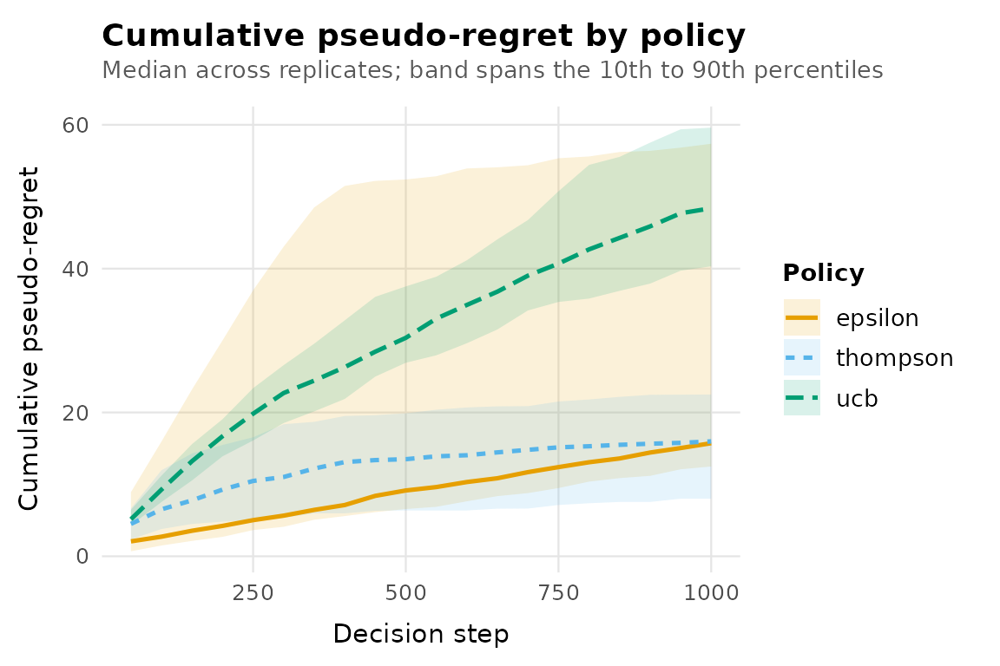
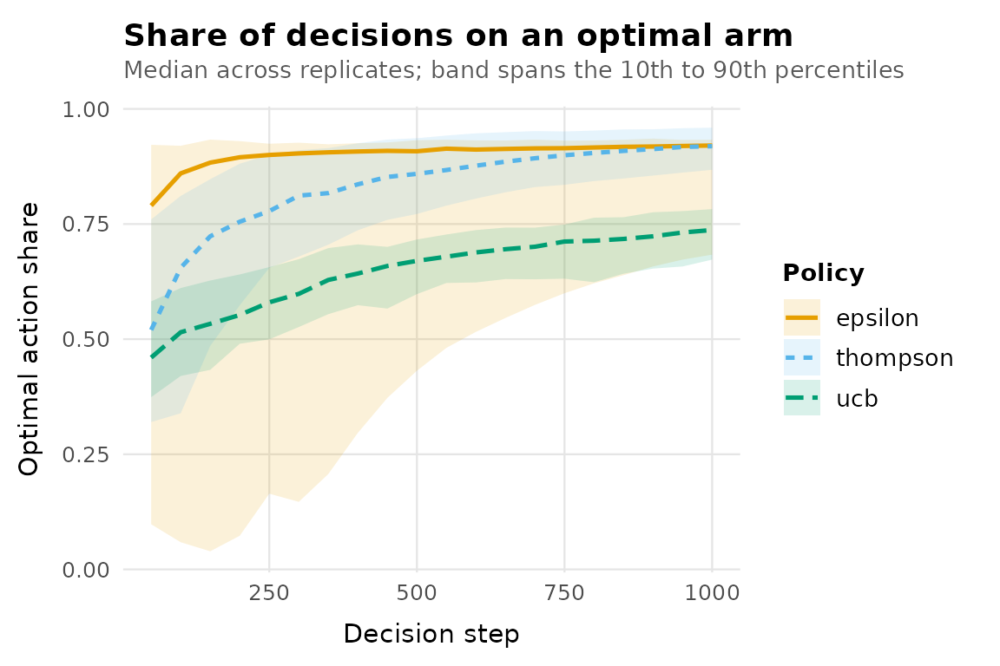

# Getting started with banditlab

A multi-armed bandit problem is a repeated decision: at every step you
choose one of several actions (arms), observe a reward only for the arm
you chose, and try to earn as much as possible while still learning
which arm is best. banditlab provides the three pieces every bandit
experiment needs: an environment that generates rewards, policies that
choose arms, and an engine that runs them together reproducibly.

``` r

library(banditlab)
```

## 1. Create an environment

An environment holds the true reward process. It is known to the
simulation and hidden from every policy.

``` r

env <- bandit_bernoulli(c(low = 0.15, mid = 0.25, high = 0.40))
env
#> <bernoulli_environment> 3 arms: low, mid, high
#> expected rewards:
#>  low  mid high 
#> 0.15 0.25 0.40 
#> optimal arm(s): high
```

## 2. Choose policies

Policy constructors store configuration only. They are independent of
any environment, so the same policy object can run against many
environments.

``` r

policies <- list(
  epsilon  = policy_epsilon_greedy(epsilon = 0.1),
  ucb      = policy_ucb1(),
  thompson = policy_thompson()
)
```

## 3. Run a replicated experiment

One run of a stochastic policy proves nothing, so the engine replicates.
The single `seed` controls everything: each replicate gets its own
independent random number stream, and every policy faces replicate `r`
from the same stream start, which makes comparisons paired by
construction.

``` r

result <- run_experiment(
  env,
  policies,
  horizon = 1000,
  replications = 50,
  seed = 42,
  checkpoints = seq(50, 1000, by = 50)
)
result
#> <bandit_result> 3 policies x 50 replicates x horizon 1000 (seed 42)
#> environment: bernoulli_environment (3 arms)
#> stored: summary + checkpoints
#> # A tibble: 3 × 8
#>   policy   replications mean_regret median_regret regret_q025 regret_q975
#> * <chr>           <int>       <dbl>         <dbl>       <dbl>       <dbl>
#> 1 epsilon            50        25.9          15.7       11.9        111. 
#> 2 ucb                50        49.1          48.4       38.3         66.2
#> 3 thompson           50        15.4          16.0        6.04        25.8
#> # ℹ 2 more variables: mean_reward <dbl>, mean_optimal_share <dbl>
```

## 4. Analyse the results

[`summary()`](https://rdrr.io/r/base/summary.html) aggregates across
replicates. The intervals are Monte Carlo quantiles across simulated
runs, not confidence intervals for a real deployment.

``` r

summary(result)
#> # A tibble: 3 × 8
#>   policy   replications mean_regret median_regret regret_q025 regret_q975
#> * <chr>           <int>       <dbl>         <dbl>       <dbl>       <dbl>
#> 1 epsilon            50        25.9          15.7       11.9        111. 
#> 2 ucb                50        49.1          48.4       38.3         66.2
#> 3 thompson           50        15.4          16.0        6.04        25.8
#> # ℹ 2 more variables: mean_reward <dbl>, mean_optimal_share <dbl>
```

The per-replicate table is an ordinary tibble, so any dplyr or ggplot2
workflow applies directly.

``` r

as_tibble(result)
#> # A tibble: 150 × 5
#>    policy  replicate total_reward cumulative_regret optimal_action_share
#>    <chr>       <int>        <dbl>             <dbl>                <dbl>
#>  1 epsilon         1          374              13.6                0.931
#>  2 epsilon         2          352              50.9                0.784
#>  3 epsilon         3          417              13.8                0.931
#>  4 epsilon         4          382              15.2                0.925
#>  5 epsilon         5          411              15.8                0.92 
#>  6 epsilon         6          399              16.7                0.917
#>  7 epsilon         7          371              18.9                0.908
#>  8 epsilon         8          377              16.3                0.918
#>  9 epsilon         9          386              15.1                0.924
#> 10 epsilon        10          369              15.6                0.921
#> # ℹ 140 more rows
```

## 5. Plot

[`autoplot()`](https://ggplot2.tidyverse.org/reference/autoplot.html)
draws the standard diagnostics. Plots are plain ggplot objects; add your
own theme or scales as usual.

``` r

autoplot(result, metric = "cumulative_regret")
```



``` r

autoplot(result, metric = "optimal_action_share")
```



## 6. Reproduce

Rerunning with the same seed gives identical results, replicate by
replicate. Results also do not depend on how many replicates you run:
replicate 7 of 50 equals replicate 7 of 500, because each replicate has
its own stream.

``` r

again <- run_experiment(env, policies, horizon = 1000,
                        replications = 50, seed = 42,
                        checkpoints = seq(50, 1000, by = 50))
identical(summary(again), summary(result))
#> [1] TRUE
```

## Where next

- [`vignette("comparing-policies")`](https://rprodigest.github.io/banditlab/articles/comparing-policies.md)
  covers paired comparisons and how to read regret.
- [`vignette("custom-policies")`](https://rprodigest.github.io/banditlab/articles/custom-policies.md)
  shows how to implement your own policy and run it in the same engine.
- [`?regret_definitions`](https://rprodigest.github.io/banditlab/reference/regret_definitions.md)
  states the exact definitions of every metric.
